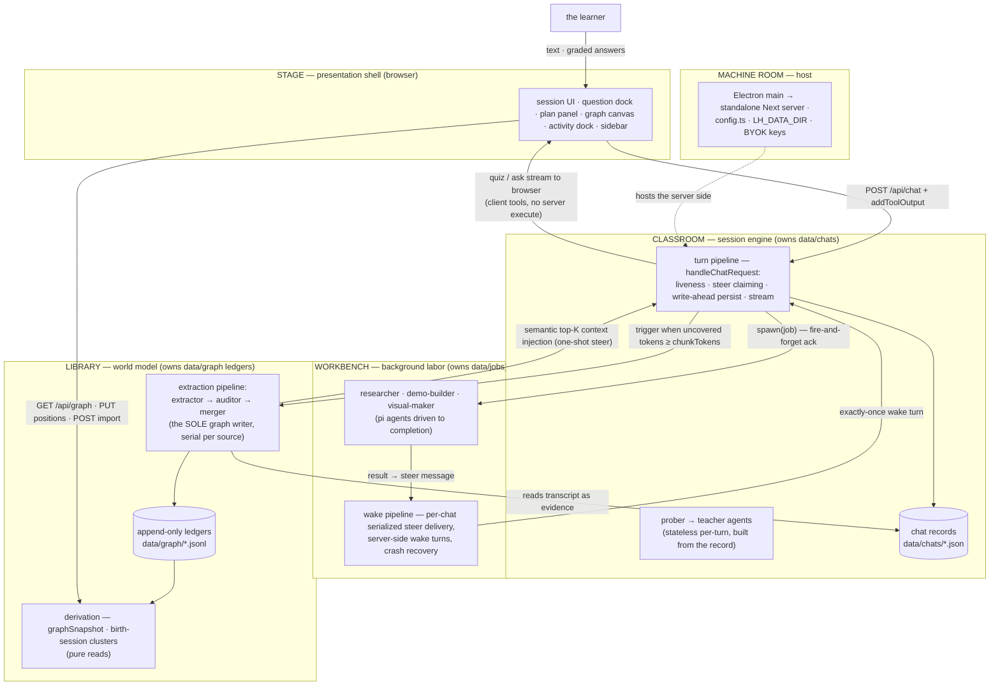

# Development guide

The developer README (split out of the storefront README, 2026-10-10). Everything below is for people working ON LearnHarness, not using it.

A standalone learning app (web + Electron desktop): a **teacher agent** (Next.js; the Vercel AI SDK's `UIMessage` protocol end-to-end, LLM engine [pi-ai](docs/pi-engine-swap.md) via OpenRouter), probe→teach lessons with graded quiz/ask interactions, a formal **session plan tree** the teacher authors once (`plan_init`) and whose progress is derived from tagged quiz calls, and a persistent cross-session **knowledge graph** of what the learner knows — the graph is the app's home page.

Not a chat app with a graph bolted on: sessions are probe→teach lessons, the plan tree is a structured, schema-validated object, sessions accumulate into the graph through the extraction pipeline (propositions + reasoning chains — the stored truth; the canvas renders a derived image), and the teacher reaches back into the graph through read-only prober tools on its own judgment so probing compounds across sessions.

- [`docs/architecture.md`](docs/architecture.md) is the **canonical architecture spec** — layers, the import law, the five systems, the invariants, the seam directory. (The pre-audit spec is archived under `docs/archive/` — history only.)
- Living design doc (all decisions): [`docs/vision.md`](docs/vision.md)
- Build plan + wave/gate results: [`docs/plan.md`](docs/plan.md)

## Commands

```bash
npm install          # once

npm run dev          # http://localhost:3000
npm run build        # production build (standalone output)
npm start            # serve the production build

npm test             # the full suite (node:test via tsx; deterministic, no LLM, no network)
npm run lint         # eslint — includes the import law (architecture §2)
npm run typecheck    # tsc --noEmit
node scripts/smoke-web-subscriptions.mjs # after build: offline Next start/dev + reload gate

npm run desktop:dev    # next dev + Electron shell pointed at it
npm run desktop:dist   # local signed/notarized macOS arm64 build (LH_NOTARY keychain)

# one-shot data scripts (run from the master tree only — data never crosses trees)
npx tsx --env-file=.env.local scripts/import-notes.ts <dir>   # bulk-import notes → graph
npx tsx --env-file=.env.local scripts/backfill-graph.ts       # wipe + re-extract every chat
npx tsx --env-file=.env.local scripts/replay-layout.ts        # re-derive layout from the ledgers
```

For Windows/Linux packages and the three-OS CI/release flow, see [`desktop-release.md`](desktop-release.md). Native renderer binaries are traced per platform, so release builds run on the target OS, not as cross-builds from macOS.

## Environment (`.env.local`)

Secrets and machine-specific paths only. Model choice and thinking budgets are the user's, not the environment's — BYOK model slots live in **settings** (`models` section: strong/cheap/vision, provider + model id + optional thinking level; per-role and per-chat overrides ride on top). The extraction batch threshold is a settings knob too (`graph.extractionChunkTokens`, default 4096, floor 500).

| Variable | Purpose |
|---|---|
| `OPENROUTER_API_KEY` | required — all LLM calls go through OpenRouter |
| `GOOGLE_SEARCH_API_KEY` + `GOOGLE_CSE_ID` | researcher's `web_search` (Google Custom Search) |
| `DEEPGRAM_API_KEY` | optional — dictation (STT token minting; audio streams browser→Deepgram, never through the server) |
| `CHROME_PATH` | optional system Chrome fallback for demo verification; the app's own browser helper is primary (nothing is downloaded) |

The packaged desktop app takes keys from `userData/auth.json` (BYOK, mode 0600, read/written directly by the server via `LH_AUTH_FILE`). PDFs render natively with pdfjs/Skia; SVGs use resvg.

### Subscription connections in web/dev

Ordinary `npm run dev` and `npm start` support the existing **ChatGPT, GitHub Copilot and Grok** connections in Settings → Providers. No separate launcher or change to Next's listening/LAN behavior is required. `npm run desktop:dev` uses these same dev-server connections; the packaged desktop app keeps its separate main-process credentials and private IPC transport.

Web/dev saves `chatgpt-credentials.json`, `github-copilot-credentials.json` and `xai-credentials.json` **beside the configured API-key `auth.json`**: the project directory by default, or the directory containing `LH_AUTH_FILE`. These are owner-only plaintext files, not files under `data/`, desktop Application Support, or a global Pi profile. Git and standalone-build exclusions cover both the files and atomic-write temporary files. Run only one server process per credential directory: refresh serialization is process-local, not a cross-process lock.

Sign-in opens a new tab in the browser that initiated it; permit that tab if your browser blocks popups. **ChatGPT sign-in must be completed in a browser on the server's machine**, because its callback listener remains `127.0.0.1` on that machine. Copilot/Grok use device codes. In the Electron dev shell, provider pages open in the system browser instead. Once connected, credentials and refresh remain server-owned; other browsers using that server share its connections and background-use consent, just as they share its API keys. Disconnect, storage-failure handling, and provider-specific background consent retain the existing behavior; subscription routes never fall back to API-key billing.

This remains a **trusted developer/shared-server mode**, not multi-user hosting. Subscription controls require same-origin JSON/custom-header requests; browser-opening actions are short-lived, origin-bound and one-use. These checks prevent ordinary cross-origin browser controls, **not user authentication or DNS-rebinding protection**. Do not expose an unprotected dev/server instance to untrusted users or the public Internet; a public deployment needs an independent access/host gate. Remote ChatGPT callback routing, per-user accounts and credential import are not implemented.

## Single-workspace Docker hosting on Coolify

The root `Dockerfile` runs the existing application unchanged: **one shared workspace**, not separate user accounts. Use a browser on your computer and phone to access `https://learn.devmoon.eu`. The upstream desktop app remains a separate local installation; it does not automatically connect or sync to this server.

### Container and persistent storage

In Coolify, select the **Dockerfile** build pack, repository-root build context, and container port **3000**. Run **one replica**; the file stores, background-job registries, and token refresh coordination assume one server process.

Mount a persistent volume at **`/var/lib/learnharness`**. The image runs as UID/GID **1000:1000**; a bind-mounted directory must be writable by that user. The image already sets:

| Variable | Container value |
|---|---|
| `LH_DATA_DIR` | `/var/lib/learnharness/data` — chats, graph, jobs, settings |
| `LH_AUTH_FILE` | `/var/lib/learnharness/auth/auth.json` — saved provider keys |
| `CHROME_PATH` | `/usr/bin/chromium` — demo verification |
| `HOSTNAME` / `PORT` | `0.0.0.0` / `3000` |

Subscription credential files live beside `auth.json`, so the same volume preserves them. The image includes Chromium and the platform-native PDF/SVG dependencies. Provider keys can be entered in Settings; environment variables still override saved values as in the upstream application. Never supply real keys as build arguments or copy `.env` files into the image.

For a local Docker smoke:

```sh
docker build -t learnharness:local .
docker volume create learnharness-state
docker run --name learnharness --restart unless-stopped \
  -p 127.0.0.1:3000:3000 \
  -v learnharness-state:/var/lib/learnharness \
  learnharness:local
```

This publishes only to the host's loopback address. In Coolify, use its persistent-storage configuration rather than creating a second volume manually. Rebuild/redeploy without deleting that volume.

### Cloudflare Access is the authentication boundary

There is **no application login or per-user isolation** in this setup. Everyone admitted through the gateway can use the same conversations, graph, keys, and subscriptions. Restrict access to yourself or explicitly trusted people.

Recommended deployment:

1. Run Cloudflare Tunnel on a private network that can reach the application container.
2. Route `learn.devmoon.eu` to `http://<application-service>:3000`.
3. Create a Cloudflare Access self-hosted application covering the **entire hostname**, including `/api/*`, and allow only your intended email identities.
4. Do not publish the application port or leave an alternate public Coolify/Traefik route. Coolify's dashboard login does **not** protect deployed applications.
5. Preserve the external `Host` and `X-Forwarded-Proto: https` headers. Allow streaming responses; do not add a “Cache Everything” rule for the application.

The app does not validate Access JWTs itself in this minimal setup. An unprotected origin bypasses the gateway. Keep the container isolated from sensitive host mounts and services; the existing agent tools are intended for a trusted personal workspace.

### Copy local data; never move or delete it

Stop writes in the old local application, then make a separate backup of its data **and** credentials. Keep that backup off the hosted server as well. Work from a copy, never by mounting the original local directory into the container.

Create a new staging directory on the server with this layout:

```text
learnharness-state/
  data/    copied contents of the old learning-data directory
  auth/    optional copied auth.json; subscription setup is separate below
```

With the hosted application stopped, copy the staged contents into an **empty** persistent volume. Do not merge over an already populated workspace. Set ownership to UID/GID 1000, restrict the `auth/` directory to mode 0700 and credential files to 0600, and compare file counts/checksums with the staging copy before starting the app. Confirm that the original local directory and your backup remain unchanged.

Keep the local originals after cutover. Future hosted edits do not synchronize back to them. For ongoing backups, stop the application or use a consistent volume snapshot, back up **both `data/` and `auth/`**, encrypt the backup, store it off-server, and periodically test a restore into a separate volume. Never use `docker compose down -v` or delete the Coolify volume unless you intend to delete the hosted data.

### ChatGPT subscriptions on a remote server

Docker does not change ChatGPT's loopback OAuth callback. Clicking its normal login from a phone or remote browser cannot deliver that callback to the container. API keys and the existing device-code providers remain available, but are not a substitute for ChatGPT subscription billing.

To reuse an existing desktop ChatGPT login, quit the desktop app and open **Settings → Providers → ChatGPT → Import ChatGPT connection…** in the hosted web app. Select `chatgpt-credentials.json` beside the installed profile's `data/` directory. This file contains credentials: upload it only to your protected LearnHarness instance, never to notes/data import or source control. The import requires idle lessons/jobs and no pending ChatGPT sign-in, validates the file, saves an owner-only backup of existing hosted credentials, and atomically replaces only the ChatGPT connection. Accounts/models refresh without restarting. Keep the desktop app quit while using the hosted copy: both copies share rotating refresh tokens. Expired or revoked logins must be renewed locally before reimporting. Learning-data backups intentionally exclude these credentials.

For ChatGPT, follow the provider's [self-hosted VM procedure](https://developers.openai.com/siwc/token-sharing-open-source/self-hosted-vms):

1. Complete authorization locally using the existing desktop application and select the intended ChatGPT registration.
2. Fully quit that application before transferring the session, so it does not compete with the server for rotating refresh tokens.
3. Open Providers on the hosted app once to initialize its own credential record and host ID, then stop the hosted app.
4. Securely transfer a **copy** of the selected registration to the server's `auth/chatgpt-credentials.json`. Preserve the server's own `hostId`; do not copy the desktop host ID over it. Preserve the selected registration's issued client ID, tokens, identity metadata, and background-use consent. Never paste credentials into chat, logs, or source control.
5. Restart the hosted app and verify the connection and model catalog. The hosted server owns subsequent refreshes. Keep the old local file, but do not reuse that transferred session concurrently; later local use may require a new authorization.

There is no new automatic credential-import feature in this minimal Docker change. This is an operator-managed transfer; live provider authorization and entitlement must be checked with the real account.


## Architecture

Five layers, dependency arrows pointing inward only, machine-enforced as four ESLint zones (shell → barrels only; core and agent never import below themselves). Two composition roots, one writer per store. The full spec — layers, systems, runtime flows, invariants, seams: [`docs/architecture.md`](docs/architecture.md).



**Core invariant:** the extraction pipeline (extractor → auditor → merger) is the sole graph writer — tree-blind and post-hoc, triggered by token coverage, not quiz counts. The LLM stages propose, verify, and judge identity (link-or-create against the current graph; each finding carries verbatim evidence and message-granular provenance); the deterministic merger owns every ledger append (ids, provenance, chain dedupe — the same argument re-asserted merges under one `arg_` id). Every node is an objective, world-facing fact; the learner's relationship to it lives entirely in practice records — feedback-only, never written back. The teacher stays a teacher; everything below the ledgers is derived.

## Layout

```
app/                            Next.js App Router — pages + 16 thin API route handlers
components/                     session + home UI, question dock, plan panel, graph
                                canvas + view, artifact renderers (registry: artifacts/),
                                dictation, activity dock, keyboard machine
src/
  agent/
    system-prompt.md            base teaching behavior (the methodology)
    prompts/{prober,teacher}/   composed numbered fragments per role
    teacher-agent.ts            prober/teacher factories (engine injectable for tests)
    tools.ts                    tool composition; quiz / ask_user_question (client tools)
    tools/plan.ts               plan_init (author-once mermaid plan, deterministic parser)
    tools/probe.ts              probe_done (probe→teach handoff seam)
    tools/jobs.ts               research / demo / visual tool surfaces
    tools/web.ts                web_search (Google CSE) + web_fetch (researcher only)
    subagents/                  researcher · demo-builder · visual-maker
                                · pdf-reader,
                                extraction pipeline (extractor/auditor + merger handoff),
                                runner (async protocol), native renderers + browser-service helper,
                                abort registry
  server/chat-handler.ts       THE turn composition root (liveness · steers · persist · stream)
  server/turn-service.ts       turn seams: persist · extraction trigger
  server/jobs.ts               the wake pipeline: serialized per-chat steer delivery,
                               server-side wake turns, crash recovery
  server/stores.ts              THE storage composition root — the one place adapters wire in
  server/turn-liveness.ts       per-chat turn registry (one turn per chat, ever)
  server/observability.ts       the activity feed (running jobs + extraction, abort)
  server/pi/                    the engine bridge: record-adapter (record → pi messages)
                                · ui-stream (pi events → UIMessage SSE)
  server/index.ts               the server barrel (the only server import app/ may use)
  core/contracts/{plan,graph,chat,jobs,probe,models}.ts
                                the contracts — one file per domain
  core/ports.ts                 storage ports — ChatStore · GraphStore · JobStore
                                (core code depends on these types only)
  core/                         question-core, plan-tree, phases, pending, graph
                                (merger/derivation), coverage, layout, clusters,
                                prices, tool-parts — all pure: storage
                                arrives as parameters
  store/                        fs adapters implementing the ports: chats · graph
                                ledgers · jobs (+ render-settings, default-settings)
electron/                       desktop launcher + security guard (spawns the standalone
                                server; 1 IPC channel; LH_DATA_DIR + BYOK env)
scripts/                        build-server.mjs (packaging guards), import-notes,
                                backfill-graph, replay-layout
data/                           chats/ · graph/ (nodes/chains/sessions/coverage
                                ledgers + positions/sources/render-settings maps) ·
                                jobs/ · settings.json — runtime state, git-ignored
```

## Key mechanisms

See [compaction and accounting](compaction-accounting.md) for the local Pi cutoff port,
measurement-only context meter, and server-side current-catalog pricing. There is no
pricing-generation step: Pi AI's catalog and public calculator are the authority.

**Client-side question tools.** `quiz` and `ask_user_question` have no server `execute`: the tool call streams to the browser, the learner answers in the dock, the client grades via `question-core` and returns the verdict with `addToolOutput` — which fires the SDK continuation so the teacher resumes mid-turn. Options are shuffled deterministically (seeded by toolCallId) so server and client renders match. A pending quiz persisted in the chat record is exactly what makes **resume mid-question free**.

**The formal plan tree (author-once).** The teacher authors the session's dependency tree with one schema-validated tool — `plan_init`, whose mermaid-subset input is parsed deterministically (line-numbered errors) and validated as a DAG. The tree persists in the chat record; progress is never mutated — `current`/`visited`/upcoming are **derived** from tagged quiz calls in the transcript, and the panel renders that derivation.

**The async sub-agent protocol (ack-and-steer).** `research` / `demo` / `visual` are server-executed tools: the call resolves immediately mid-turn with a fire-and-forget ack and the teacher keeps teaching; a background runner works in parallel (the client polls `/api/activity` and `/api/jobs`). On completion the runner builds a **steer message** — a user-role `UIMessage` whose text part is the model-facing result and whose `data-subagent-artifact` part carries the full result for the client — and the **wake pipeline** delivers it: a per-chat serialized queue waits for the turn to end and no question to be pending, then fires a server-side teacher turn that weaves the result into the lesson. Delivery is exactly-once (deterministic steer ids, delivered-flag checks at every claim point); stalled jobs are recovered on read; aborted jobs deliver an abort steer. The client adopts the wake turn through the same `turnInFlight` machinery as returning mid-stream (busy shimmer, composer gate) and renders steers as artifacts — never a bubble. Sub-agents **verify, never one-shot**: the demo-builder executes its HTML in the app's own Chromium browser-service (system Chrome fallback) before delivery; the visual-maker rasterizes each SVG natively and looks at it (vision-capable model — the `vision` slot in settings).

**The knowledge graph (two channels, one writer).** The write channel: the extraction pipeline — extractor (LLM: sees the source — the session's teacher prose or a notes chunk — plus its own source's digest (**THE GRAPH SO FAR**: propositions + chains already extracted from this source, ids verbatim — digest-aware redesign, 2026-09-30 evening: the extractor IS the assembler, referencing existing ids instead of restating, leaning on established conclusions as premises); fully trusted; its deliverable is core ideas + reasoning chains: premises that jointly entail a conclusion, submitted as chains and stored as chains — `chains.jsonl` is the truth, edges a derived view; owner redesign + chains-primary, 2026-09-30) → auditor (LLM, an agentic loop that never sees the source: explores the existing graph through `find` / `list_sessions` / `list_propositions` tools and stamps each proposition with an identity verdict — link to an existing node (equivalence bias: paraphrases merge) or create) → merger (`mergeFindings`, deterministic: applies the verdicts, link-appends phrasings/provenance, resolves and dedupes chains — identical arguments merge under one `arg_` id; then the chain-simplification pass strips provably redundant derivations — prefer-fewest-premises + ancestry-cover — checkpoints coverage) → layout settle. A source's batches run strictly in order (each extractor continues the digest of every earlier merge). No quiz outcomes or understanding assessments live in the graph (2026-09-27 cleanup); practice (`/practice`) consumes the graph as feedback-only problem sets and writes nothing back. Triggered when a chat's **uncovered tokens** (message-view fingerprints, `coverage.jsonl`) cross `graph.extractionChunkTokens` (a settings knob, default 8192, floor 500 — read fresh per turn); failure checkpoints nothing, the next trigger re-runs. The same pipeline serves the **notes front door** (`POST /api/graph/import`: any `*.md`/`*.txt` becomes a source; re-imports are idempotent by path hash). The read channel: `GET /api/graph` derives the snapshot from the ledgers — a pure read (`deriveView` rebuilds the lossy image: each chain an implication node `⟹` with premise→implication→conclusion arrows, so two arguments for one conclusion stay two diamonds); the home view is a hand-rolled Canvas 2D renderer (one rAF loop, dirty-flag idle, d3-zoom camera, zoom-gated labels, cluster hulls) over a d3-force layout, with server-persisted render settings and drag-committed positions. Clusters are **birth-session groupings**: a node joins the cluster of the session that birthed it (a chat, or an imported notes file as a file-kind session), derived at read — no embedding pass, no naming pass. The teacher reaches the graph on its own terms through the gated prober tools (`list_sessions` / `list_propositions`, the `agent.graphTools` setting) — there is no automatic context injection.

**Practice (problem sets).** A node selection resolves to the STORED reasoning chains it fully contains (a chain rides iff every member is selected; unchained nodes ride as singletons); the `/practice` creation dialog picks a birth-session cluster (the graph view's own groups) and freezes its propositions + chains into a self-contained `ProblemSet`. Three named-level axes steer generation (ladder rung 0–4, cue distance 0–2, Theory|Application — never a number to interpolate; defaults Direct exercise · Adjacent context · Theory), plus an optional free-form note the agents weigh but need not follow. Creation has two entries: the cluster picker on `/practice`, or the graph view's chain table — a full-bleed sortable table of every reasoning chain, grouped by birth cluster under the shared top bar, selecting chips, chains, or whole clusters, whose floating selection bar shows the exact `N nodes → M chains` the agents will receive — handing a free-form node selection to the same dialog — and carries the fenced Delete action, making it the graph's management view (whole-cluster cleanup through the same full-death confirm dialog). A partitioner agent covers every chain exactly once, one generator per partition writes problems against the owner's problem-engineering framework (commit-before-pose: statement + solution + rubric together), and grading is **strengthening, not assessment** — one attempt per problem with its own submit button, instant solution/rubric reveal, then a score 0–10 with brief reasoning landing live; nothing ever written back to the graph. Runs are registry-backed background jobs on the activity dock (no steer, never wakes the teacher); sets live in `data/practice`, crash-swept on boot.

**Dictation.** Optional speech-to-text: the server mints short-lived Deepgram tokens; audio streams browser→Deepgram over WebSocket, never through the server.

## Testing

All deterministic, no LLM, no network (engines are injected — pi-ai's faux provider scripted per test; `globalThis.fetch` stubbed where transport matters):

1. **Pure core units** — merger (via the real fs adapters, backup-and-restored), derivation, coverage, question grading, plan tree, phases, clusters, layout, tool-parts, prices.
2. **Server flows** — `handleChatRequest` driven end-to-end with scripted engines: persistence, liveness, steer claiming, the wake pipeline (409 retry, quiz deferral, idempotency), crash recovery, the data-dir seam (including a fresh child process).
3. **Sub-agent loops** — researcher/demo-builder/visual-maker with fake headless APIs; the extraction pipeline end-to-end (audit drops, failure-checkpoints-nothing, single-flight, abort).
4. **Render tests** — transcript, cards, docks, composer, sidebar, coverage via React server-side rendering.
5. **Golden fixtures** (`tests/fixtures/golden-data/`) — a REAL data dir (real records produced by the app, never hand-edited), copied to a temp dir and read through the production paths via the `LH_DATA_DIR` seam. Pins that real data parses, flattens to a legal LLM wire, derives the graph end-to-end, covers every custom-marker kind, and that reads never write. **The fixture law:** an intentional on-disk format change updates the fixtures in the same commit — see the fixture README.

## Lineage

The teaching methodology comes from an Obsidian-based POC (its `knowledge graph design.md` was the original epistemic-model source, since amended — see the amendments table in `docs/vision.md`). The harness was originally built on the pi agent SDK, pivoted to standalone Next.js + the Vercel AI SDK, and later swapped its LLM engine back to pi-ai while keeping the AI SDK's `UIMessage` as the client protocol ([`docs/pi-engine-swap.md`](docs/pi-engine-swap.md)).

## Data

Nothing under `data/` is ever tracked by git. Chats, graph ledgers, jobs, positions, and the settings records are plain files (JSON/JSONL) — inspect them freely; they are the canonical records. The desktop app relocates the whole directory via `LH_DATA_DIR`.

**Schema stamps (2026-10-10):** chat records carry `version` (stamped at the store's write choke point; absence reads as v1 — lazy migration, no mass rewrite), and the graph family (ledgers, sources, render-settings) shares one sidecar `graph/format.json`, created on the family's first write. `positions.json` is deliberately unstamped (rebuildable). A record stamped NEWER than the running build is refused on read — honest refusal for the downgrade scenario: a read-modify-write store never rewrites what it doesn't understand.
